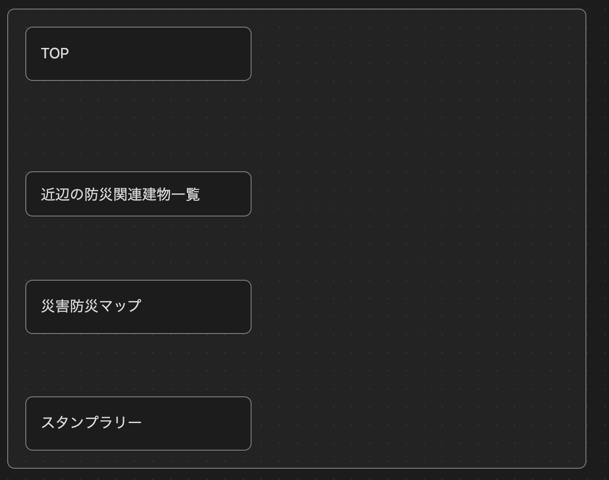
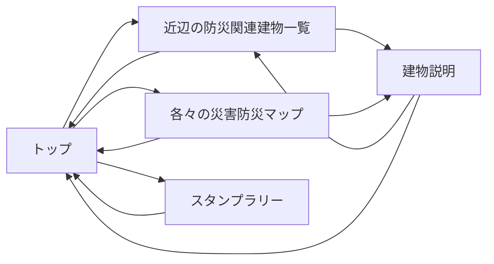
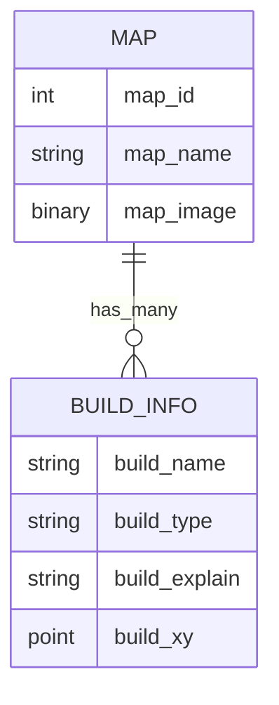

# SWEXE-Team3
# 基本設計書：

- チーム番号：チーム03
- メンバー：米森 隆之介、Qin Lang

## 課題
- **選んだ課題**：まちのインフラを知る防災学習
- **誰の課題か**：教育委員会の九条さん
- **なぜこの課題を選んだか**：昨今、災害が多くなっている世の中いつ大きな災害が私たちの身を襲うかわからないため、子供達に小さい頃から防災について触れておいてほしいため
- **元になった自治体課題**：[まちのインフラをめぐる学び旅](https://www.park.itc.u-tokyo.ac.jp/padit/cog2026/area/chugoku.html#yamaguchi-list)

## 0. 考えを整理する3つの問い
- **開発目的**：災害の被害を減らしたい。子供達に災害の際、自主的に動けるようにしたい。
- **想定ユーザ**：小中学校の生徒たち、教師たち　サブターゲット：地域住民
- **機能**：災害ごとに避難する場所を示したマップの表示、様々なインフラ・防災関連の場所を通るためのルートの提示、学習を進めるにつれてスタンプラリーを埋めていく

## 1. ユーザーストーリー
- ストーリー1：【教師A】「子供達に防災に関連する地域のことをもっと知ってほしいがどうしても学習を進める途中で飽きてしまう子がいるためその子達を飽きさせない工夫が欲しい」
- ストーリー2：【教師B】「防災マップを作成する際に地域の避難場所等を知らない子達もたくさんいるためそれらを一気に回れるルートマップが欲しい」
- ストーリー3：【生徒C】「校外学習で防災学習があるけど面白くない」

## 2. 画面イメージ（ワイヤーフレーム）

## 3. ページ遷移図

## 4. データモデル（ER図）

## 5. 開発着手の許可基準に対する自己チェック
- [ ☑️] 課題の具体性：身近な実在のペインに基づいているか？
- [ ☑️] 連動性：ユーザーストーリーと画面・データモデルが破綻なく繋がっているか？
- [ ☑️] ボリュームの妥当性：第14回までに2名で作りきれる規模感か？
