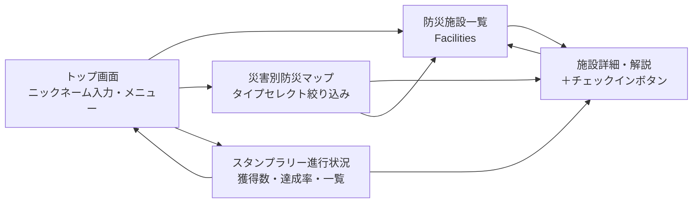
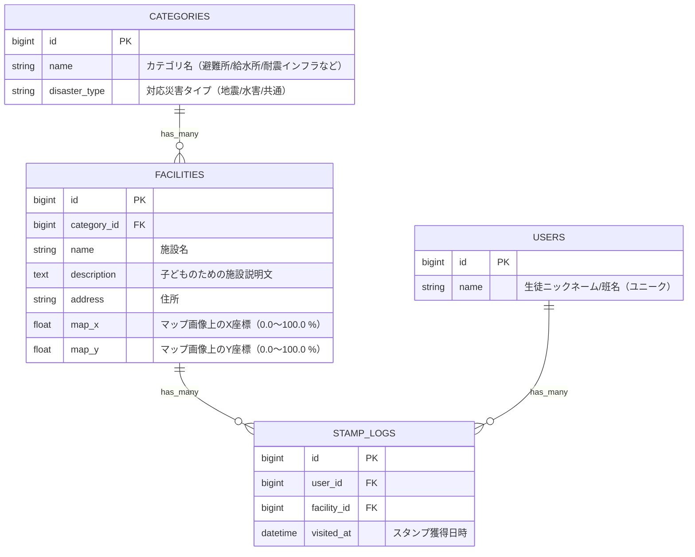

# 基本設計書：まちのインフラを知る防災学習アプリ

- **チーム番号**：チーム03
- **メンバー**：米森 隆之介、Qin Lang

---

## 課題定義
- **選んだ課題**：まちのインフラを知る防災学習
- **誰の課題か**：教育委員会の九条さん（および地域の小中学校の先生方）
- **なぜこの課題を選んだか**：災害が頻発する昨今、いざという時に子どもたちが自主的に判断して行動できるよう、幼少期から地域の防災インフラに親しんでほしいため。
- **元になった自治体課題**：[まちのインフラをめぐる学び旅（山口県美祢市など）](https://www.park.itc.u-tokyo.ac.jp/padit/cog2026/area/chugoku.html#yamaguchi-list)

---

## 0. 考えを整理する3つの問い
- **開発目的**：子どもたちが災害時に自主的に動けるよう、校外学習を通じて地域の防災インフラ・避難場所を楽しく学べる Web アプリを提供する。
- **想定ユーザ**：
  - メインターゲット：小中学校の生徒（児童・生徒）、引率する教員
  - サブターゲット：地域住民
- **技術構成**：
  - Ruby 3.4.9 / Ruby on Rails 8.1.3 / PostgreSQL
  - 地図表示：外部地図 API や JavaScript 地図ライブラリに依存しない **静的マップ画像＋純粋 Ruby/ERB＋CSS 相対座標配置**
- **主要機能 (MVP)**：
  1. **防災施設一覧・詳細解説**：地域の避難所・給水拠点・耐震インフラの一覧表示および子ども向け解説の表示
  2. **災害別防災マップ**：静的マップ画像上に施設ピンを表示し、災害種別・カテゴリで絞り込み可能にする
  3. **スタンプラリー（チェックイン機能）**：ニックネーム／班名での簡易ログイン後、施設詳細画面の「チェックイン」ボタンでスタンプを獲得し、達成状況を確認できる
- **今後の拡張予定（MVP スコープ外・将来対応）**：
  - おすすめ防災見学コース（`courses` / `course_spots` テーブルを追加して対応可能な設計を維持）
  - 教員向け施設登録・編集画面（CRUD）

---

## 1. ユーザーストーリー
- **ストーリー1【教員】**：
  子どもたちが飽きずに防災学習に取り組めるよう、**ニックネーム／班名ですぐ始められるスタンプラリー形式**で楽しく回れる仕組みを提供したい。
- **ストーリー2【生徒・地域】**：
  地震・水害などの災害タイプ別に、**どの防災施設や避難場所が対応しているかをマップ上で直感的に確認**できるようにしたい。
- **ストーリー3【生徒】**：
  施設を訪れた際に詳細画面から**ワンクリックでスタンプを獲得し、全体の達成率や残り施設数をひと目で確認**したい。

---

## 2. 画面イメージ（ワイヤーフレーム）
- トップ画面：[design/TOP.png](design/TOP.png)
- 防災マップ画面：[design/マップ.png](design/%E3%83%9E%E3%83%83%E3%83%95%E3%82%9A.png)

---

## 3. ページ遷移図

---

## 4. データモデル（ER図）
※ Rails の規約（スネークケース・複数形テーブル・外部キー命名）および PostgreSQL に最適化しています。
※ 施設データ・カテゴリデータは初期投入（`db/seeds.rb`）で管理します。

### 制約・業務ルール
1. **簡易認証（セッション管理）**：パスワードは設けず、`USERS.name` を入力してセッション（`session[:user_id]`）に保持する（同名ユーザーがいれば再利用、なければ新規作成）。
2. **重複チェックイン防止**：`STAMP_LOGS` に `(user_id, facility_id)` の複合ユニークインデックスを設定し、1人につき各施設1回のみスタンプ獲得可能とする。
3. **座標範囲**：`FACILITIES.map_x` および `map_y` は `0.0` 以上 `100.0` 以下の数値とする。

---

## 5. 開発着手の許可基準に対する自己チェック
- [x] **課題の具体性**：教育委員会や学校現場の「防災学習が座学中心で飽きられる・地理が頭に入らない」という実在のペインに基づいている。
- [x] **連動性**：ユーザーストーリー（簡易参加・災害別マップ確認・スタンプラリー）と ER 図・画面遷移図が過不足なく一致している。
- [x] **ボリュームと分担の妥当性**：静的マップ＋純粋 Ruby ロジック＋Rails 標準機能にスコープを絞り、DB 不要の単体テストと PostgreSQL 結合テストを切り分けて第14回までに完成・検証可能な設計としている。

---

## 6. 開発タスク分担・テスト方針
詳細な共通基盤の定義、独立テスト可能なモジュール分割、2人でのタスク分担については [DEVELOPMENT_PLAN.md](DEVELOPMENT_PLAN.md) を参照してください。
