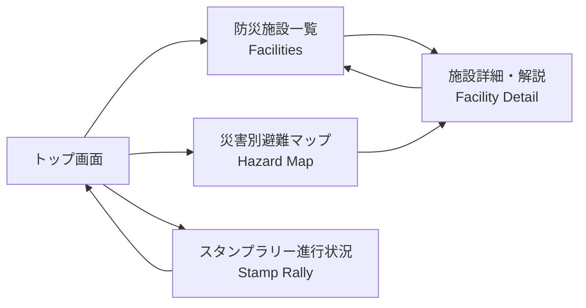
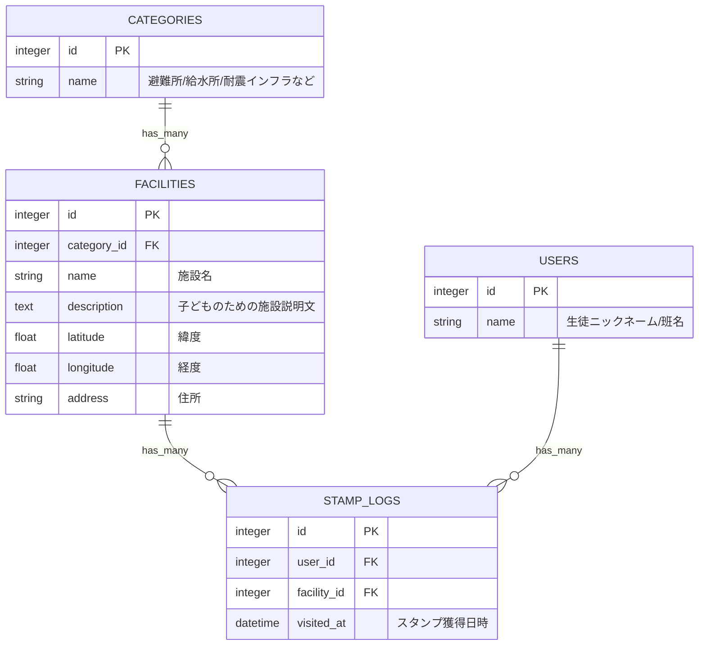

# 基本設計書：まちのインフラを知る防災学習アプリ

- **チーム番号**：チーム03
- **メンバー**：米森 隆之介、Qin Lang

---

## 課題定義
- **選んだ課題**：まちのインフラを知る防災学習
- **誰の課題か**：教育委員会の九条さん（および地域の小中学校の先生方）
- **なぜこの課題を選んだか**：災害が頻発する昨今、いざという時に子どもたちが自主的に判断して行動できるよう、幼少期から地域の防災インフラに親しんでほしいため。
- **元になった自治体課題**：[まちのインフラをめぐる学び旅（山口県美祢市など）](https://www.park.itc.u-tokyo.ac.jp/padit/cog2026/area/chugoku.html#yamaguchi-list)

---

## 0. 考えを整理する3つの問い
- **開発目的**：子どもたちが災害時に自主的に動けるよう、校外学習を通じて地域の防災インフラ・避難場所を楽しく学べるWebアプリを提供する。
- **想定ユーザ**：
  - メインターゲット：小中学校の生徒（児童・生徒）、引率する教員
  - サブターゲット：地域住民
- **主要機能 (MVP)**：
  1. 防災施設・インフラマップのピン表示と詳細解説
  2. おすすめ防災見学コース（ルート）の提示
  3. 各スポットを巡って達成感を味わえるスタンプラリー（チェックイン機能）

---

## 1. ユーザーストーリー
- **ストーリー1【教員】**：
  子どもたちが飽きずに防災学習に取り組めるよう、**スタンプラリー感覚で楽しく回れる仕組み**を提供したい。
- **ストーリー2【教員・地域】**：
  避難場所や重要インフラ（給水拠点・避難所など）を網羅した**安全な見学おすすめコース（ルート）**を一覧から確認させたい。
- **ストーリー3【生徒】**：
  地域の避難場所や防災施設を実際に訪れて**スタンプを集め、達成状況をひと目で確認**したい。

---

## 2. 画面イメージ（ワイヤーフレーム）
- トップ画面：`design/top.png`
- 防災マップ画面：`design/map.png`

---

## 3. ページ遷移図

---

## 4. データモデル（ER図）
※ Railsの規約（スネークケース・複数形テーブル・外部キー naming）に最適化しています。

---

## 5. 開発着手の許可基準に対する自己チェック
- [x] **課題の具体性**：教育委員会や学校現場の「防災学習が座学中心で飽きられる・地理が頭に入らない」という実在のペインに基づいている。
- [x] **連動性**：ユーザーストーリー（学習の動機付け・スタンプ・マップ確認）と、ER図（施設・カテゴリ・スタンプ履歴）が過不足なく一致している。
- [x] **ボリュームの妥当性**：難易度の高い動的ナビゲーションは排し、施設マスタ管理＋マップ表示＋スタンプ訪問記録という Rails 8 の基本 CRUD ＋ α にスコープを絞り、第14回までに十分完成可能な設計に収めている。